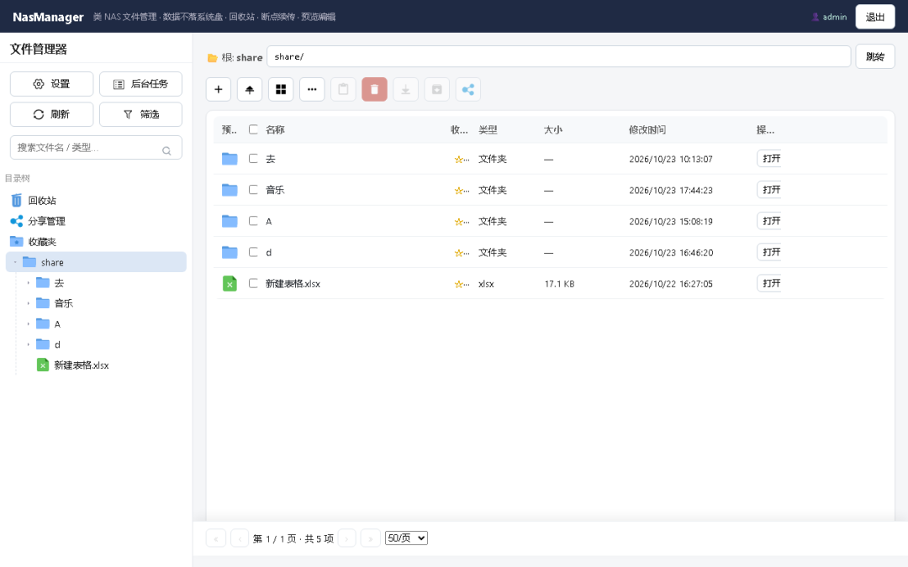
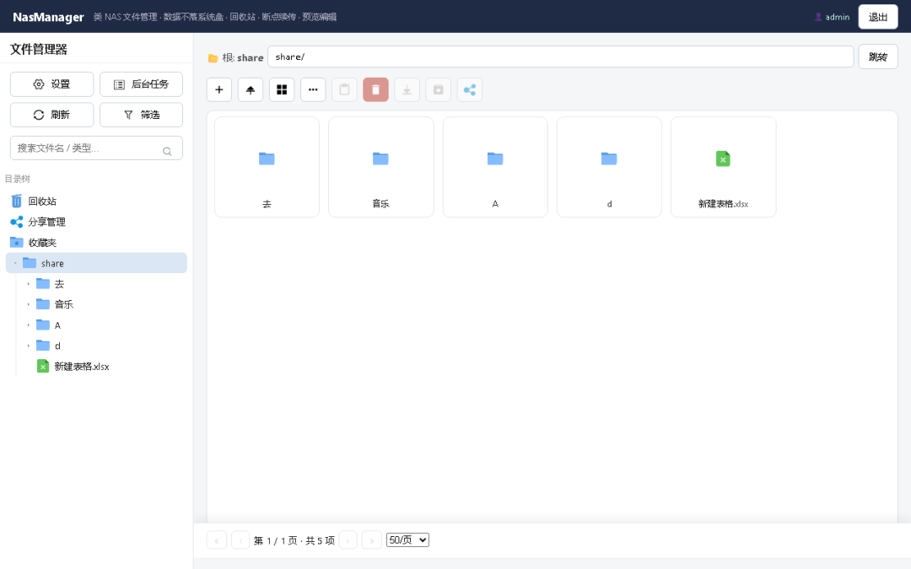
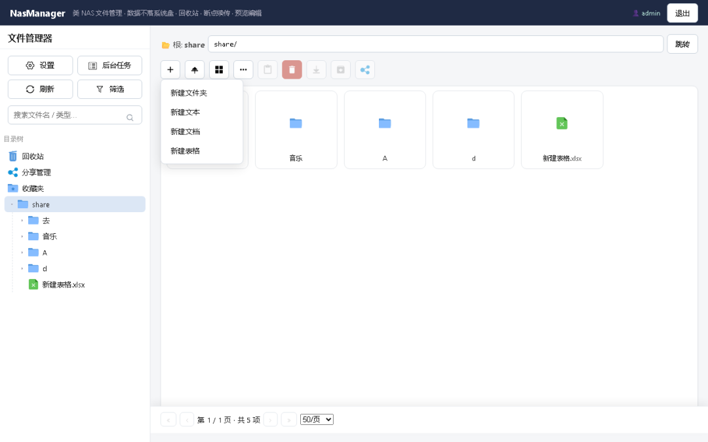
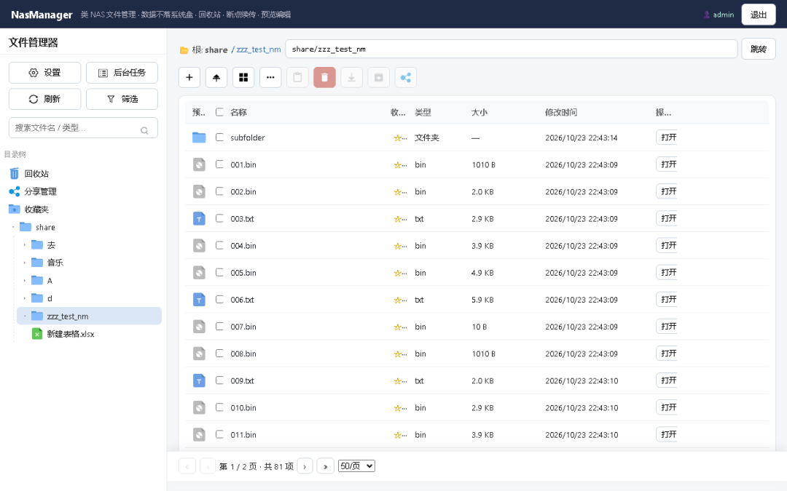

# NasManager

> Windows 原生、网页访问的类 NAS 文件管理器。零安装客户端，对齐 QNAP File Station 的核心体验。

文件始终留在 Windows 本机磁盘上；应用数据（索引、缩略图、会话、备份）与盘符解耦，默认放在项目目录下，单 C 盘机器也能正常使用。删除走系统回收站，可还原。

[界面预览](#界面预览) · [核心特性](#核心特性) · [快速开始](#快速开始) · [配置](#配置) · [桌面端](#桌面端) · [API](docs/API.md)

---

## 界面预览

| 列表视图 | 平铺视图 |
|---|---|
|  |  |

| 新建菜单 | 文件夹浏览 |
|---|---|
|  |  |

---

## 核心特性

- **真实 Windows 路径** —— 左侧目录树 + 地址栏显示原生路径，支持「列表 / 平铺 / 幻灯片」三种视图、批量选择、排序与输入路径跳转。
- **大文件断点续传** —— 基于 TUS 可恢复分片协议，支持 100GB 级传输、文件夹与拖拽上传，断网续传不重传。
- **系统盘二次确认** —— 系统盘上的写操作需前端确认（返回 `423 SYSTEM_DRIVE_CONFIRM`）；个人主目录即使在系统盘也免确认。
- **回收站** —— 删除通过 `SHFileOperation(FOF_ALLOWUNDO)` 进入 Windows 回收站，可在文件管理器中浏览 / 还原 / 清空。
- **全局搜索** —— 文件名 / 类型 / 大小 / 日期多维过滤，索引在后台异步分块构建，扫描全盘也不卡死。
- **在线预览与编辑** —— 文本内置编辑器（保存自动备份 `.bak`、JSON 一键格式化）；图片 / 视频 / 音频 / PDF 原生预览；Excel / Word / PPT 只读预览。
- **压缩与解压** —— 右键压缩为 ZIP，支持 AES-256 加密；ZIP / TAR.GZ 解压到此处或新文件夹，可直接预览压缩包内容。
- **共享链接** —— 生成免登录临时链接，可设密码与有效期。
- **WebDAV** —— 内置 `/dav` 服务，可把「此电脑」全部磁盘挂载为网络驱动器（仅管理员）。
- **多用户与权限** —— 管理员可创建子账号，分配可访问根目录与 read / write / delete 权限；每个账号有独立个人空间，并可自助改密。
- **实时刷新** —— SSE 事件流推送目录变化，无需轮询。
- **文件版本** —— 文本文件保存时自动留存历史版本（默认 90 天），可浏览 / 还原 / 下载。
- **去重与校验** —— SHA-256 校验和、按内容哈希扫描重复文件。
- **后台任务** —— 上传 / 压缩 / 解压 / 复制进入任务队列，可暂停 / 继续 / 取消。
- **自动 HTTPS** —— 内置 Let's Encrypt ACME 申请与续期，也可指定本机证书或由 Caddy / Nginx 反代终结 TLS。
- **自愈守护** —— `supervisor.js` 通过协调端口选举单实例，服务崩溃或假死时自动重启。
- **桌面端** —— 可选 Electron 程序，托盘常驻，窗口关闭隐藏到托盘而不是退出服务。

---

## 技术栈

| 层 | 技术 |
|---|---|
| 后端 | Node.js + Express 4，模块化拆分于 `src/`，无数据库依赖（JSON 落盘） |
| 前端 | Vue 3 单页应用，内联于 `public/index.html`，无构建步骤 |
| 上传 | `@tus/server` + `@tus/file-store`（可恢复分片） |
| 媒体 | `sharp` 缩略图、`archiver` 压缩、`mammoth` / `xlsx` Office 预览 |
| HTTPS | `acme-client`（Let's Encrypt） |
| 桌面 | Electron（可选） |

---

## 快速开始

环境要求：Node.js ≥ 18，Windows 64 位。

```bat
git clone <repo-url> NasManager
cd NasManager
npm install
copy .env.example .env
npm start
```

打开浏览器访问 `http://localhost:8080`，默认管理员 `admin`。未设置 `AUTH_PASSWORD` 时，首次启动会生成随机密码并写入 `DATA_DIR/secrets/initial_admin_password.txt`。

后台常驻运行用 `start_nas.bat`；注册为 Windows 服务用 `install-service.bat`（需 `nssm.exe`）。

---

## 配置

复制 `.env.example` 为 `.env` 后修改。完整字段见 `.env.example`。

| 变量 | 说明 | 默认 |
|---|---|---|
| `DATA_DIR` | 应用数据目录（索引 / 缩略图 / 上传临时），与盘符解耦 | `<项目>/data` |
| `USER_HOME_BASE` | 用户个人主目录基地，`<基地>/<用户名>` 为私有空间 | `<项目>/home` |
| `SYSTEM_DRIVES` | 系统盘列表，这些盘上的写操作需二次确认 | `C` |
| `ROOTS` | 用户文件根目录，多组 `名:路径` 分号分隔 | `share:D:\Share` |
| `PORT` | 主服务端口 | `8080` |
| `AUTH_USERNAME` / `AUTH_PASSWORD` | 管理员账号；密码留空则随机生成 | `admin` / 自动生成 |
| `HTTPS_CERT` / `HTTPS_KEY` / `HTTPS_PORT` | 本机 TLS 证书与端口 | 不设 / `443` |
| `LETSENCRYPT_ENABLED` / `LETSENCRYPT_DOMAINS` / `LETSENCRYPT_EMAIL` | ACME 自动证书 | `false` |
| `VERSIONS_MAX_AGE_DAYS` | 文件历史版本保留天数 | `90` |

更多开关（WebDAV、隐藏文件扫描、回收站自动清理等）可在运行期通过 Web 设置面板或 `POST /api/settings` 调整并持久化。

---

## 架构

```
浏览器（Vue 3 SPA，零安装）
        │ HTTP / HTTPS
server.js  ── 鉴权 / 根目录隔离 / 文件操作 / TUS 上传 / 搜索 / WebDAV / ACME
        │ 协调端口选举
supervisor.js  ── 崩溃 / 假死自愈重启
```

- 单实例由协调端口保证；主服务用另一协调端口避免重复绑定。
- 回收站通过 PowerShell 脚本调用 Shell COM，与 Windows 资源管理器共用同一回收站。
- 所有可变数据落在 `DATA_DIR`，不写入仓库、不依赖系统盘符。

主要目录：

```
server.js          Express 主服务
supervisor.js      守护进程
config.js          配置读取
src/               paths / auth / recycle / thumbnails / search / webdav / share
                   / versions / dedup / office / acme / jobs 等模块
scripts/           PowerShell 回收站脚本
public/            index.html（前端）、login.html、vendor
electron/          Windows 桌面程序
docs/API.md        API 参考
```

---

## 桌面端

`electron/` 目录下是可选的 Windows 桌面程序，主进程负责窗口、托盘与设置 IPC。关闭窗口默认隐藏到托盘，服务继续运行；托盘菜单可退出程序。

开发调试：`npm run electron:dev`。打包 exe：`npm run dist` 或 `npm run dist:portable`。

---

## 安全

- 登录采用一次性 nonce 防重放；会话 Cookie `HttpOnly + SameSite=Strict`（HTTPS 下加 `Secure`），失败 IP 限流。
- 静态文件 `safeJoin` 校验路径穿越；WebDAV 仅管理员可用。
- 建议公网暴露前启用 HTTPS（ACME 或反向代理）并配置防火墙规则。

---

## 许可证

MIT —— 详见仓库根目录 `LICENSE`。
